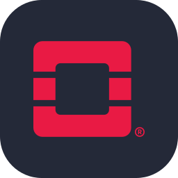
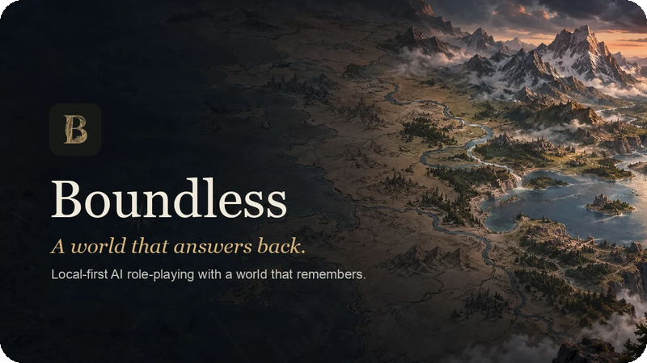
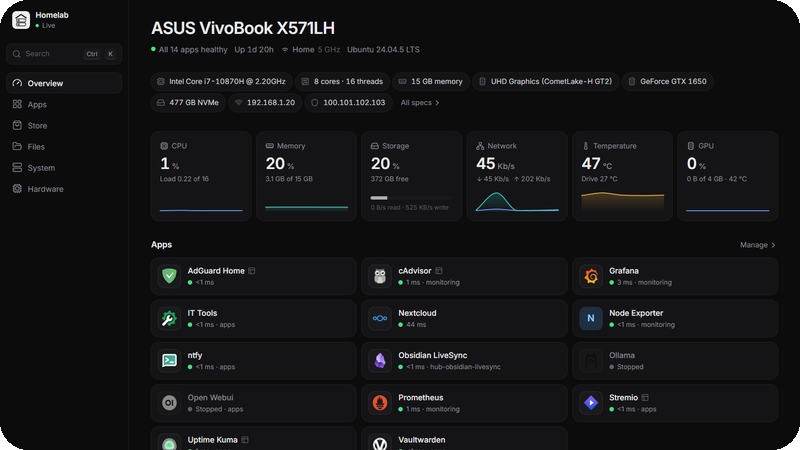
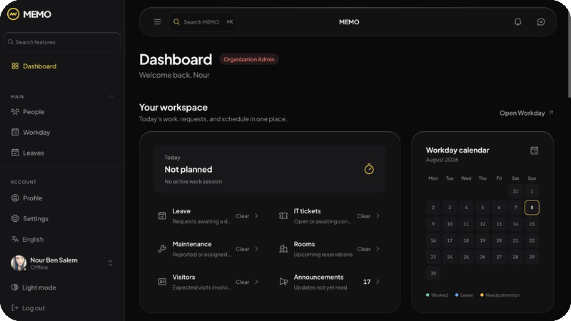
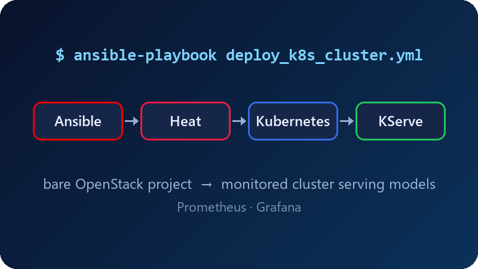
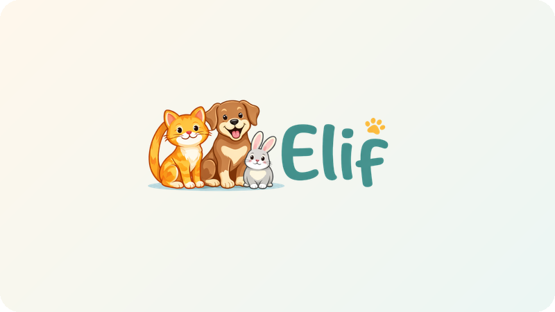

<h1 align="center">Hi, I'm Malek Bsaissa</h1>
<h3 align="center">Cloud & DevOps engineering student at ESPRIT</h3>

I automate the infrastructure and build the apps that run on it.

  
  
  

## About me

- 🎓 Final-year Computer Science engineering student at ESPRIT, specializing in **Cloud Computing & DevOps** (graduating 2027)
- ☁️ Most at home with **Kubernetes, Ansible and Terraform** on the infra side, and **Spring Boot, FastAPI and Angular/React** on the app side
- 🔭 Currently building **[Boundless](https://github.com/AtfastrSlushyMaker/boundless)**, a local-first AI role-playing game, and **[Homelab Hub](https://github.com/AtfastrSlushyMaker/homelab-hub)**, a control panel for my home server
- 🧪 Exploring local LLMs, self-hosting and geospatial data

  

  
  
  

## Tools I've worked with

<table>
  <tr>
    <td><b>Cloud & DevOps</b></td>
    <td>  
      
      </td>
  </tr>
  <tr>
    <td><b>Languages</b></td>
    <td></td>
  </tr>
  <tr>
    <td><b>Backend</b></td>
    <td> 
      
      
      
      
      </td>
  </tr>
  <tr>
    <td><b>Frontend</b></td>
    <td></td>
  </tr>
  <tr>
    <td><b>Data & AI</b></td>
    <td> 
      
      
      
      </td>
  </tr>
</table>

  
<b>Projects</b> (click to expand)

   

<table>
  <tr>
    <td width="50%" valign="top">
      
      <h3><a href="https://github.com/AtfastrSlushyMaker/boundless">Boundless</a></h3>
      An AI Game Master that runs on your own machine and never forgets what you did.
       Next.js · FastAPI · pgvector · Ollama
    </td>
    <td width="50%" valign="top">
      
      <h3><a href="https://github.com/AtfastrSlushyMaker/homelab-hub">Homelab Hub</a></h3>
      A home-server control panel that discovers what's running instead of asking you.
       Go · React · Docker · systemd
    </td>
  </tr>
  <tr>
    <td width="50%" valign="top">
      
      <h3><a href="https://github.com/AtfastrSlushyMaker/memo">MEMO</a></h3>
      Multi-tenant workplace platform with real-time messaging and an AI assistant.
       Angular · Spring Boot · PostgreSQL · Kubernetes
    </td>
    <td width="50%" valign="top">
      
      <h3><a href="https://github.com/AtfastrSlushyMaker/ansible-openstack-k8s">OpenStack → Kubernetes</a></h3>
      One playbook from an empty OpenStack project to a monitored cluster serving models.
       Ansible · Heat · Kubernetes · Grafana
    </td>
  </tr>
  <tr>
    <td width="50%" valign="top">
      
      <h3><a href="https://github.com/AtfastrSlushyMaker/Elif">Elif</a></h3>
      Pet-care community platform with real-time chat and an AI agent for community search.
       Angular · Spring Boot · MySQL · FastAPI
    </td>
    <td width="50%" valign="top">
      
      <h3><a href="https://github.com/AtfastrSlushyMaker/tvdeck">TVDeck</a></h3>
      My Samsung TV's home screen had ads, so I replaced it.
       JavaScript · Tizen · TizenBrew
    </td>
  </tr>
</table>

## Socials

  
  
  

